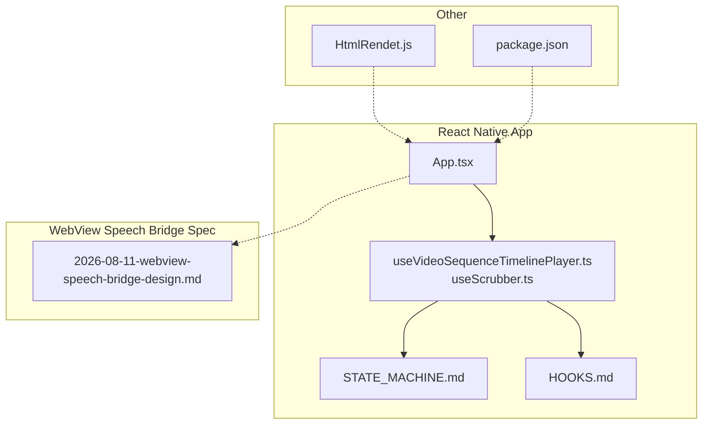
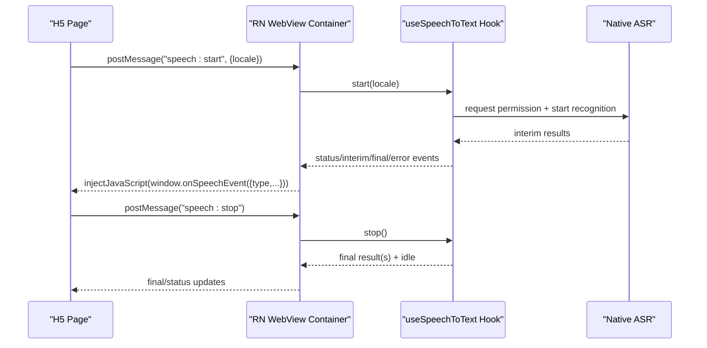
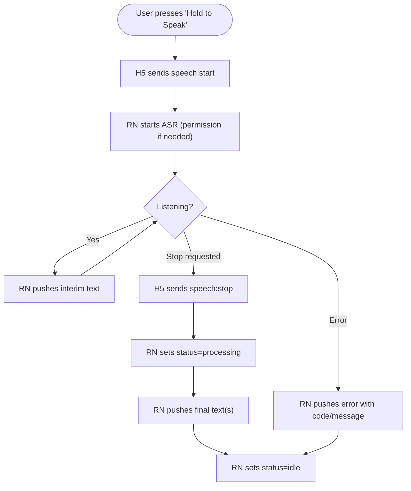
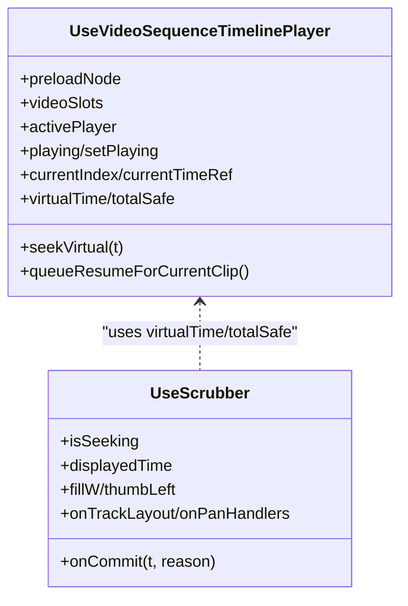
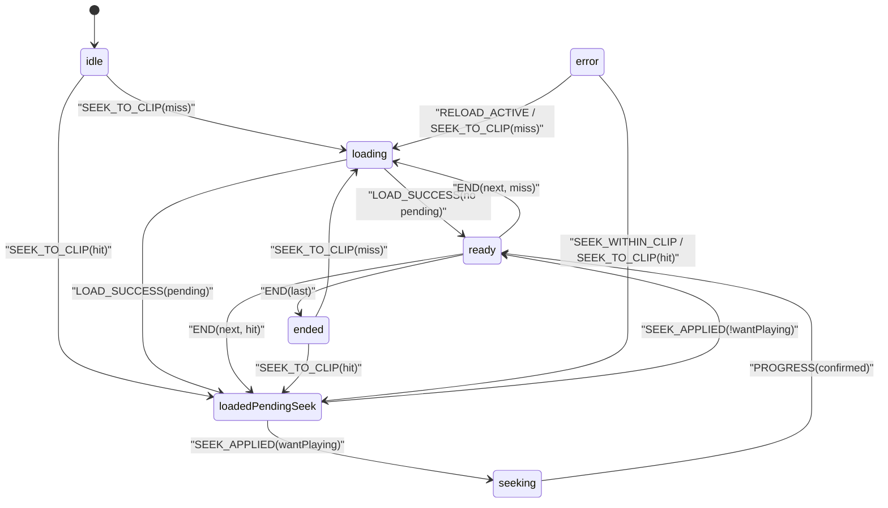
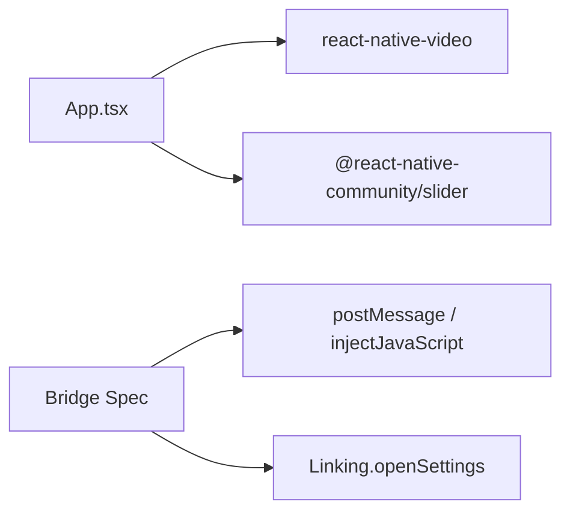

# WebView Speech Bridge

<cite>
**Referenced Files in This Document**
- [2026-08-11-webview-speech-bridge-design.md](file://docs/superpowers/specs/2026-08-11-webview-speech-bridge-design.md)
- [App.tsx](file://App.tsx)
- [useVideoSequenceTimelinePlayer.ts](file://hooks/useVideoSequenceTimelinePlayer.ts)
- [useScrubber.ts](file://hooks/useScrubber.ts)
- [STATE_MACHINE.md](file://docs/STATE_MACHINE.md)
- [HOOKS.md](file://docs/HOOKS.md)
- [HtmlRendet.js](file://Componment/HtmlRendet.js)
- [package.json](file://package.json)
</cite>

## Table of Contents
1. Introduction
2. Project Structure
3. Core Components
4. Architecture Overview
5. Detailed Component Analysis
6. Dependency Analysis
7. Performance Considerations
8. Troubleshooting Guide
9. Conclusion
10. Appendices

## Introduction
This document describes the WebView Speech Bridge design and how it integrates with the React Native video stitching application. The bridge enables an H5 page running inside a React Native WebView to use native speech recognition on iOS and Android by exchanging JSON messages between the web layer and the RN container. It also documents the surrounding video playback architecture that coexists with the bridge, including the virtual timeline, scrubbing, and sequence player state machine.

## Project Structure
The repository is a React Native app focused on playing multiple MP4 clips as one continuous timeline, plus a design spec for a WebView-based speech-to-text bridge. Key areas:
- App entry and UI orchestration: App.tsx
- Video playback hooks and composition: hooks/useVideoSequenceTimelinePlayer.ts, hooks/useScrubber.ts
- Documentation for state machine and hooks: docs/STATE_MACHINE.md, docs/HOOKS.md
- WebView Speech Bridge design spec: docs/superpowers/specs/2026-08-11-webview-speech-bridge-design.md
- A small HTML renderer component (for reference): Componment/HtmlRendet.js
- Dependencies: package.json

**Diagram sources**
- [App.tsx:1-800](file://App.tsx#L1-L800)
- [useVideoSequenceTimelinePlayer.ts:1-98](file://hooks/useVideoSequenceTimelinePlayer.ts#L1-L98)
- [useScrubber.ts:1-273](file://hooks/useScrubber.ts#L1-L273)
- [STATE_MACHINE.md:1-607](file://docs/STATE_MACHINE.md#L1-L607)
- [HOOKS.md:1-461](file://docs/HOOKS.md#L1-L461)
- [2026-08-11-webview-speech-bridge-design.md:1-391](file://docs/superpowers/specs/2026-08-11-webview-speech-bridge-design.md#L1-L391)
- [HtmlRendet.js:1-42](file://Componment/HtmlRendet.js#L1-L42)
- [package.json:1-39](file://package.json#L1-L39)

**Section sources**
- [App.tsx:1-800](file://App.tsx#L1-L800)
- [package.json:1-39](file://package.json#L1-L39)

## Core Components
- WebView Speech Bridge (design): Defines the contract between H5 and RN for speech recognition via postMessage and injectJavaScript, including message types, lifecycle, error handling, and platform considerations.
- Video Sequence Player Engine: Composes duration preloading, dual-slot playback, virtual timeline mapping, and scrubbing into a single facade hook used by the app.
- Scrubber Hook: Handles drag-to-seek interactions, preview time, and commits seeks to the engine.
- State Machine: Formalizes playback phases, seek confirmation, clip transitions, and error recovery.

**Section sources**
- [2026-08-11-webview-speech-bridge-design.md:1-391](file://docs/superpowers/specs/2026-08-11-webview-speech-bridge-design.md#L1-L391)
- [useVideoSequenceTimelinePlayer.ts:1-98](file://hooks/useVideoSequenceTimelinePlayer.ts#L1-L98)
- [useScrubber.ts:1-273](file://hooks/useScrubber.ts#L1-L273)
- [STATE_MACHINE.md:1-607](file://docs/STATE_MACHINE.md#L1-L607)
- [HOOKS.md:1-461](file://docs/HOOKS.md#L1-L461)

## Architecture Overview
The WebView Speech Bridge sits alongside the video playback stack. The app renders a mission screen and fullscreen video modal; the bridge would be integrated into a WebView container that hosts H5 content. The bridge uses:
- H5 → RN: window.ReactNativeWebView.postMessage(JSON)
- RN → H5: webViewRef.injectJavaScript calling window.onSpeechEvent(data)

**Diagram sources**
- [2026-08-11-webview-speech-bridge-design.md:60-73](file://docs/superpowers/specs/2026-08-11-webview-speech-bridge-design.md#L60-L73)
- [2026-08-11-webview-speech-bridge-design.md:112-193](file://docs/superpowers/specs/2026-08-11-webview-speech-bridge-design.md#L112-L193)
- [2026-08-11-webview-speech-bridge-design.md:196-271](file://docs/superpowers/specs/2026-08-11-webview-speech-bridge-design.md#L196-L271)

## Detailed Component Analysis

### WebView Speech Bridge Contract
- Message types from H5 to RN:
  - speech:start with optional locale
  - speech:stop
  - speech:openSettings
- Messages from RN to H5:
  - interim text (draft)
  - final text (incremental per sentence)
  - status changes (idle, listening, processing, error)
  - error with normalized code and message
- Idempotency:
  - Multiple speech:start while already listening are ignored
  - speech:stop when not listening is a no-op
- Error handling:
  - mic-denied, network, max-duration, rate-limited, not-available, unknown
  - On mic-denied, H5 can prompt user to open system settings via speech:openSettings
- Lifecycle safeguards:
  - H5 cleans up on unmount and sends speech:stop
  - RN handles app backgrounding to stop recording

**Diagram sources**
- [2026-08-11-webview-speech-bridge-design.md:60-73](file://docs/superpowers/specs/2026-08-11-webview-speech-bridge-design.md#L60-L73)
- [2026-08-11-webview-speech-bridge-design.md:112-193](file://docs/superpowers/specs/2026-08-11-webview-speech-bridge-design.md#L112-L193)
- [2026-08-11-webview-speech-bridge-design.md:196-271](file://docs/superpowers/specs/2026-08-11-webview-speech-bridge-design.md#L196-L271)

**Section sources**
- [2026-08-11-webview-speech-bridge-design.md:60-73](file://docs/superpowers/specs/2026-08-11-webview-speech-bridge-design.md#L60-L73)
- [2026-08-11-webview-speech-bridge-design.md:112-193](file://docs/superpowers/specs/2026-08-11-webview-speech-bridge-design.md#L112-L193)
- [2026-08-11-webview-speech-bridge-design.md:196-271](file://docs/superpowers/specs/2026-08-11-webview-speech-bridge-design.md#L196-L271)

### Video Playback Composition (Contextual Integration)
The app composes duration preloading, dual-slot playback, and virtual timeline into a single facade hook. It exposes:
- Preload node for metadata discovery
- Video slots to render
- Virtual time and total safe duration
- Seek abstraction over clip boundaries
- Scrubber integration via isSeeking gating

**Diagram sources**
- [useVideoSequenceTimelinePlayer.ts:1-98](file://hooks/useVideoSequenceTimelinePlayer.ts#L1-L98)
- [useScrubber.ts:1-273](file://hooks/useScrubber.ts#L1-L273)
- [HOOKS.md:166-251](file://docs/HOOKS.md#L166-L251)
- [HOOKS.md:254-339](file://docs/HOOKS.md#L254-L339)
- [HOOKS.md:341-438](file://docs/HOOKS.md#L341-L438)

**Section sources**
- [useVideoSequenceTimelinePlayer.ts:1-98](file://hooks/useVideoSequenceTimelinePlayer.ts#L1-L98)
- [useScrubber.ts:1-273](file://hooks/useScrubber.ts#L1-L273)
- [HOOKS.md:166-251](file://docs/HOOKS.md#L166-L251)
- [HOOKS.md:254-339](file://docs/HOOKS.md#L254-L339)
- [HOOKS.md:341-438](file://docs/HOOKS.md#L341-L438)

### State Machine for Sequence Playback
The playback engine uses a formal FSM with two orthogonal dimensions:
- Playback phase: idle, loading, loadedPendingSeek, seeking, ready, ended, error
- User gesture: isSeeking (dragging)

Key behaviors:
- Seek applied vs confirmed: seek token alignment and first PROGRESS confirmation
- Clip transitions on END with preload hit/miss
- Error recovery with watchdog effect and limited retries
- Stale event defense across three layers

**Diagram sources**
- [STATE_MACHINE.md:17-73](file://docs/STATE_MACHINE.md#L17-L73)
- [STATE_MACHINE.md:139-180](file://docs/STATE_MACHINE.md#L139-L180)
- [STATE_MACHINE.md:198-331](file://docs/STATE_MACHINE.md#L198-L331)
- [STATE_MACHINE.md:335-403](file://docs/STATE_MACHINE.md#L335-L403)
- [STATE_MACHINE.md:406-441](file://docs/STATE_MACHINE.md#L406-L441)
- [STATE_MACHINE.md:444-500](file://docs/STATE_MACHINE.md#L444-L500)

**Section sources**
- [STATE_MACHINE.md:17-73](file://docs/STATE_MACHINE.md#L17-L73)
- [STATE_MACHINE.md:139-180](file://docs/STATE_MACHINE.md#L139-L180)
- [STATE_MACHINE.md:198-331](file://docs/STATE_MACHINE.md#L198-L331)
- [STATE_MACHINE.md:335-403](file://docs/STATE_MACHINE.md#L335-L403)
- [STATE_MACHINE.md:406-441](file://docs/STATE_MACHINE.md#L406-L441)
- [STATE_MACHINE.md:444-500](file://docs/STATE_MACHINE.md#L444-L500)

### App Integration Points
- App orchestrates fullscreen modal, controls, and scrubbing using the composed engine.
- The bridge would integrate into a WebView container within this app, sharing the same navigation and control surfaces.
- The HTML renderer component demonstrates DOM interaction patterns relevant to H5-side link interception; similar patterns apply to intercepting voice button events in H5.

**Section sources**
- [App.tsx:33-485](file://App.tsx#L33-L485)
- [HtmlRendet.js:1-42](file://Componment/HtmlRendet.js#L1-L42)

## Dependency Analysis
- The app depends on react-native-video for playback and community slider for UI.
- The bridge design references third-party speech SDKs conceptually (e.g., @dbkable/react-native-speech-to-text or vendor-specific SDKs), but none are installed in this repo’s dependencies.
- The bridge relies on standard React Native APIs: WebView postMessage/injectJavaScript and Linking.openSettings.

**Diagram sources**
- [package.json:12-17](file://package.json#L12-L17)
- [2026-08-11-webview-speech-bridge-design.md:60-73](file://docs/superpowers/specs/2026-08-11-webview-speech-bridge-design.md#L60-L73)
- [2026-08-11-webview-speech-bridge-design.md:196-227](file://docs/superpowers/specs/2026-08-11-webview-speech-bridge-design.md#L196-L227)

**Section sources**
- [package.json:12-17](file://package.json#L12-L17)
- [2026-08-11-webview-speech-bridge-design.md:60-73](file://docs/superpowers/specs/2026-08-11-webview-speech-bridge-design.md#L60-L73)
- [2026-08-11-webview-speech-bridge-design.md:196-227](file://docs/superpowers/specs/2026-08-11-webview-speech-bridge-design.md#L196-L227)

## Performance Considerations
- Bridge messaging:
  - Keep payloads minimal; prefer incremental final text to reduce bridge traffic.
  - Ensure JSON serialization on both sides; avoid sending non-string messages from H5.
- ASR performance:
  - Prefer native SDKs for stable performance and lower latency.
  - Handle network errors gracefully; surface rate limits and timeouts to users.
- Video playback:
  - Dual-slot preloading reduces transition gaps.
  - Virtual timeline math avoids unnecessary re-renders by using refs for time and version ticks.
  - Scrubber defers commit until release to minimize seek churn.

[No sources needed since this section provides general guidance]

## Troubleshooting Guide
- Bridge issues:
  - If H5 does not receive events, verify WebView onMessage parsing and prefix filtering for speech: messages.
  - Confirm pushToH5 uses JSON.stringify and ends with true; ensure webViewRef exists before injection.
  - For permissions denied, ensure H5 shows “Go to Settings” and RN opens system settings via Linking.
- Video playback issues:
  - If stuck in loading/seeking/ended states, consult the state machine transitions and stale event guards.
  - Check active slot identity and loadKey consistency to discard stale events.
  - Use watchdog retry behavior to recover from transient network errors.

**Section sources**
- [2026-08-11-webview-speech-bridge-design.md:196-271](file://docs/superpowers/specs/2026-08-11-webview-speech-bridge-design.md#L196-L271)
- [STATE_MACHINE.md:544-586](file://docs/STATE_MACHINE.md#L544-L586)

## Conclusion
The WebView Speech Bridge design provides a clear, idempotent contract for enabling speech recognition in H5 pages hosted by React Native. It complements the existing video stitching pipeline by keeping audio capture and ASR logic in RN while leaving UI control in H5. The robust video playback state machine and scrubbing hooks ensure a smooth viewing experience, while the bridge adds interactive voice input capabilities through a well-defined message protocol.

[No sources needed since this section summarizes without analyzing specific files]

## Appendices
- Recommended next steps:
  - Implement the WebView container in the app to host H5 content and wire postMessage/injectJavaScript per the spec.
  - Add a simple H5 demo page implementing the bridge contract for testing.
  - Integrate a native ASR SDK via a hook following the spec’s interface and error normalization.

[No sources needed since this section provides general guidance]