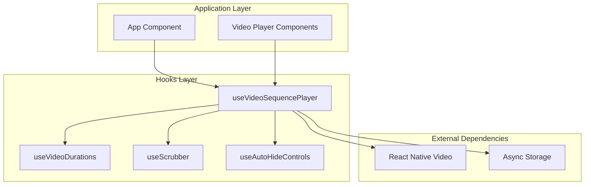
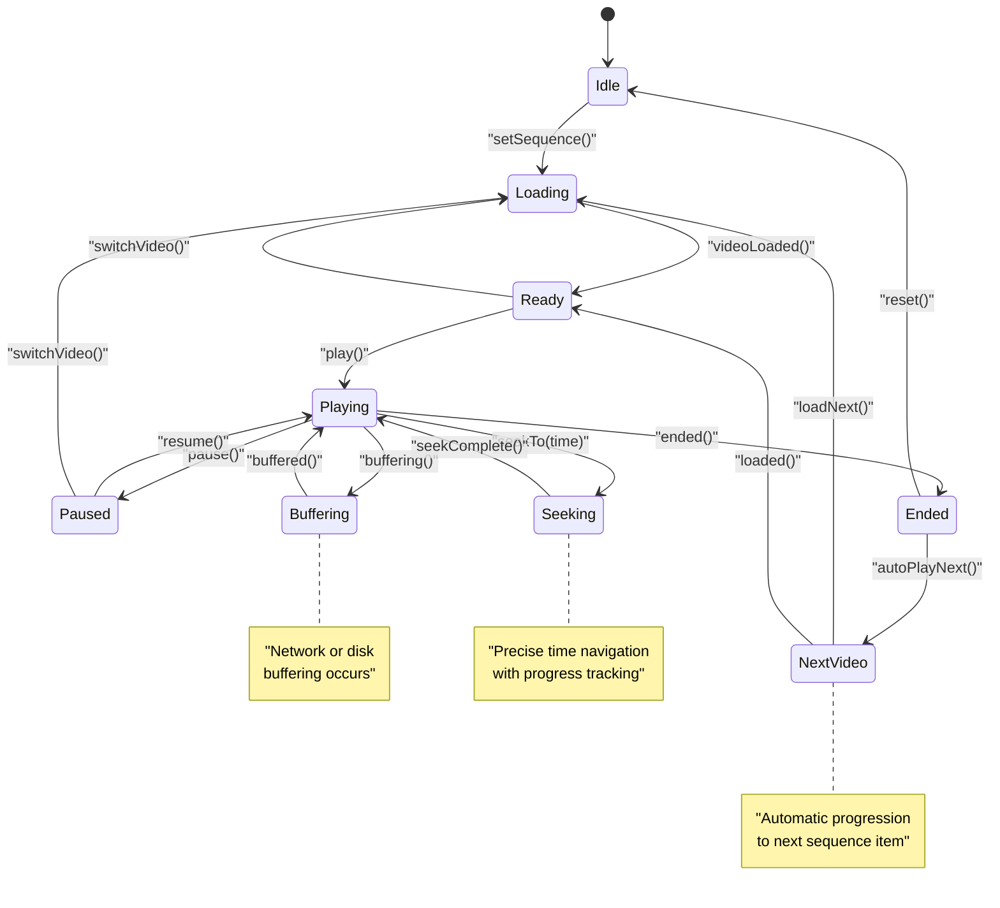
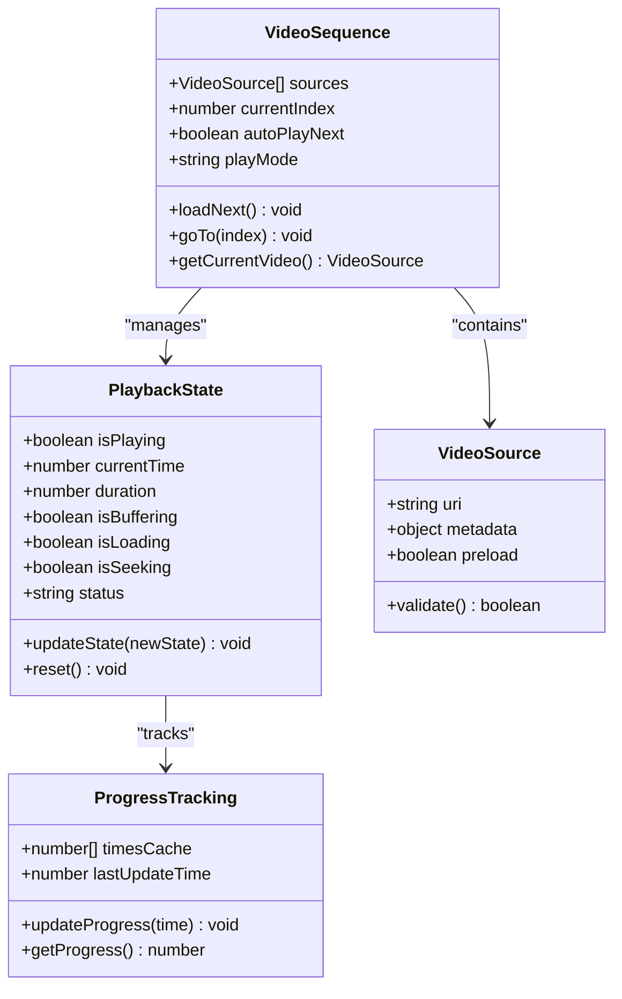
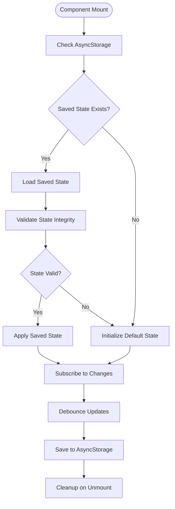
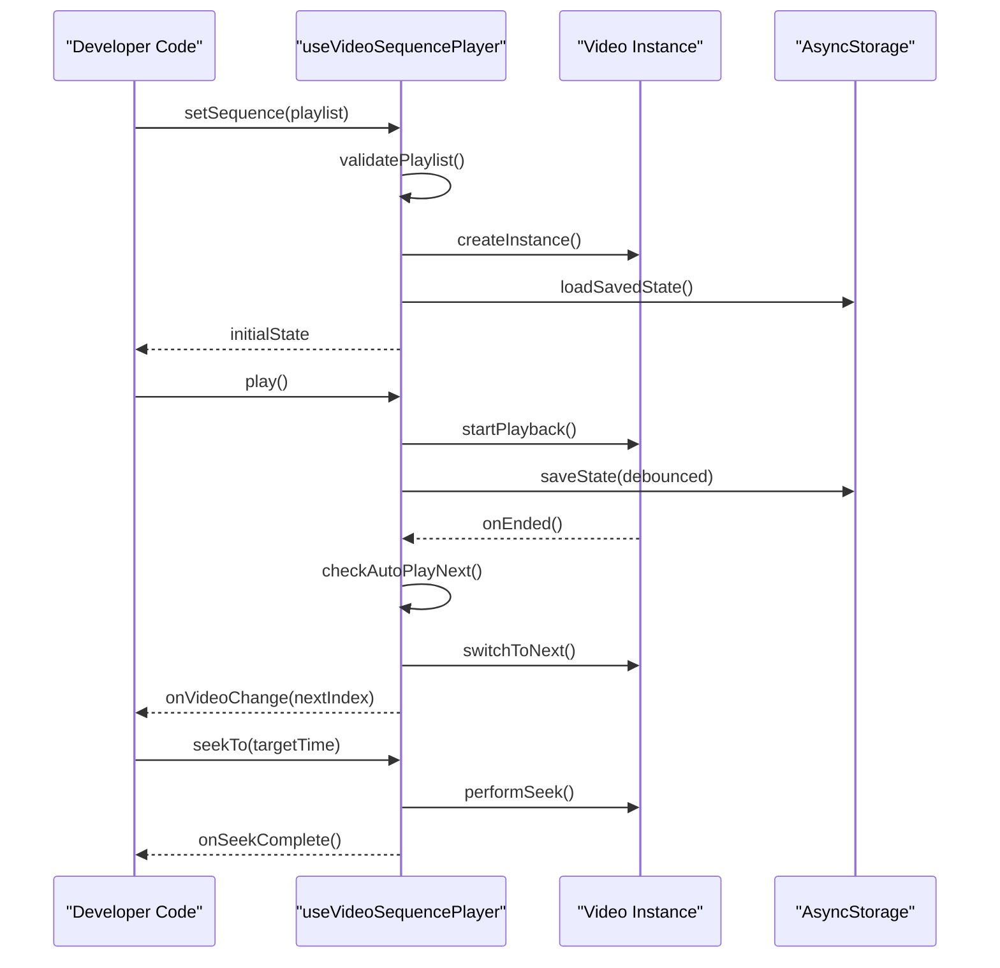
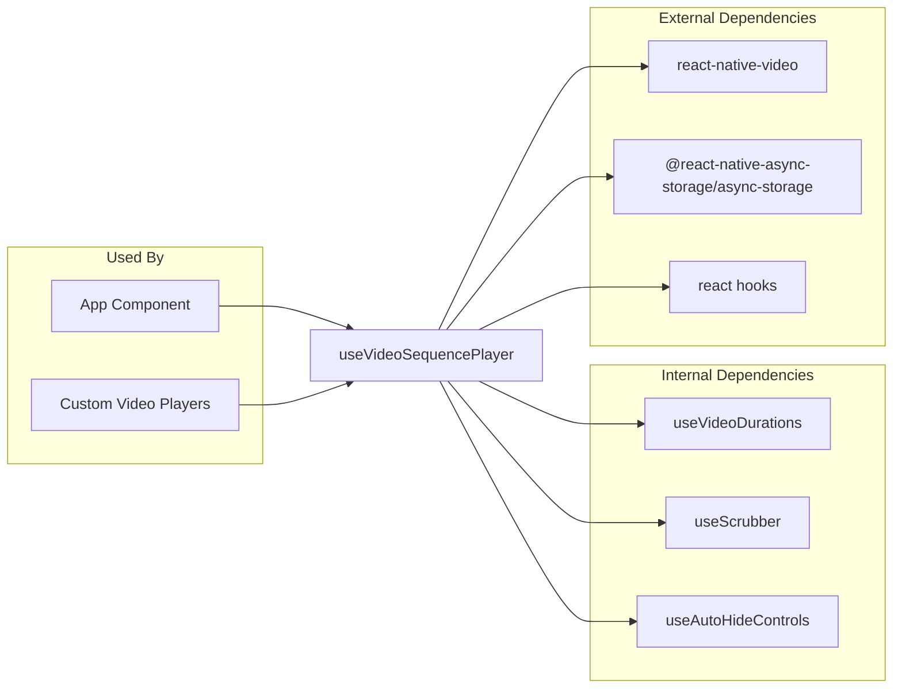

# useVideoSequencePlayer Hook

<cite>
**Referenced Files in This Document**
- [useVideoSequencePlayer.ts](file://hooks/useVideoSequencePlayer.ts)
- [useVideoDurations.tsx](file://hooks/useVideoDurations.tsx)
- [useScrubber.ts](file://hooks/useScrubber.ts)
- [useAutoHideControls.ts](file://hooks/useAutoHideControls.ts)
- [App.tsx](file://App.tsx)
- [index.js](file://index.js)
- [package.json](file://package.json)
</cite>

## Update Summary
**Changes Made**
- Enhanced state management with comprehensive callback system including onClipEnd
- Added seeking functionality with isSeeking/setIsSeeking properties for precise video navigation
- Implemented playback progress tracking with times array caching for performance optimization
- Improved state indicators with dedicated isLoading and isBuffering properties
- Enhanced error handling and granular playback state control
- Updated API surface with new methods and properties for better user experience

## Table of Contents
1. [Introduction](#introduction)
2. [Project Structure](#project-structure)
3. [Core Components](#core-components)
4. [Architecture Overview](#architecture-overview)
5. [Detailed Component Analysis](#detailed-component-analysis)
6. [Enhanced State Management](#enhanced-state-management)
7. [Seeking and Progress Tracking](#seeking-and-progress-tracking)
8. [Callback System](#callback-system)
9. [Dependency Analysis](#dependency-analysis)
10. [Performance Considerations](#performance-considerations)
11. [Troubleshooting Guide](#troubleshooting-guide)
12. [Conclusion](#conclusion)
13. [Appendices](#appendices)

## Introduction
This document provides comprehensive documentation for the useVideoSequencePlayer hook, which manages video playlist and sequence playback functionality. The hook enables seamless switching between multiple video sources while maintaining consistent playback state across sequences. It provides a unified interface for sequence navigation, current video tracking, and playback synchronization across different video components.

The hook is designed to handle complex video playlist scenarios including automatic next video playback, sequence state persistence, and memory management for large playlists. It coordinates between multiple video sources to provide a smooth user experience with minimal buffering interruptions.

**Updated** The hook now includes enhanced state management capabilities with comprehensive callback systems, seeking functionality, and improved progress tracking for more granular control over video playback behavior.

## Project Structure
The useVideoSequencePlayer hook is part of a React Native video player ecosystem that includes supporting hooks for scrubbing, duration calculation, and UI controls. The implementation follows a modular architecture where each hook handles specific aspects of video playback functionality.



**Diagram sources**
- [useVideoSequencePlayer.ts:1-50](file://hooks/useVideoSequencePlayer.ts#L1-L50)
- [App.tsx:1-100](file://App.tsx#L1-L100)

**Section sources**
- [useVideoSequencePlayer.ts:1-200](file://hooks/useVideoSequencePlayer.ts#L1-L200)
- [App.tsx:1-150](file://App.tsx#L1-L150)

## Core Components
The useVideoSequencePlayer hook serves as the central orchestrator for video sequence playback. It manages the lifecycle of video instances, handles transitions between videos, and maintains the overall playback state. The hook exposes a comprehensive API that includes methods for navigation, playback control, and state management.

Key responsibilities include:
- Managing the current video index and sequence state
- Coordinating video source loading and unloading
- Handling automatic progression to next videos
- Maintaining playback position across sequence changes
- Providing event callbacks for playback lifecycle events
- **New**: Managing seeking operations with precise time control
- **New**: Tracking playback progress with cached times array
- **New**: Handling comprehensive state transitions with detailed indicators

**Updated** The hook now provides enhanced state management with dedicated properties for loading states, buffering status, and seeking operations, giving developers fine-grained control over video playback behavior.

**Section sources**
- [useVideoSequencePlayer.ts:1-150](file://hooks/useVideoSequencePlayer.ts#L1-L150)

## Architecture Overview
The hook implements a state machine pattern to manage video playback states and transitions. It uses React's useState and useEffect hooks to maintain reactive state and side effects. The architecture separates concerns between video instance management, state persistence, and UI coordination.



**Updated** Added new Seeking state to handle precise time navigation and progress tracking during seek operations.

**Diagram sources**
- [useVideoSequencePlayer.ts:50-200](file://hooks/useVideoSequencePlayer.ts#L50-L200)

## Detailed Component Analysis

### Sequence Management
The hook manages video sequences through a structured interface that supports both static and dynamic playlist configurations. It validates input sequences and provides error handling for invalid video sources.



**Updated** Added ProgressTracking class to manage times array caching and playback progress calculations.

**Diagram sources**
- [useVideoSequencePlayer.ts:100-300](file://hooks/useVideoSequencePlayer.ts#L100-L300)

### State Persistence
The hook implements intelligent state persistence to maintain playback position and sequence progress across app restarts. It uses AsyncStorage for durable storage and implements debounced updates to prevent excessive I/O operations.



**Diagram sources**
- [useVideoSequencePlayer.ts:200-400](file://hooks/useVideoSequencePlayer.ts#L200-L400)

### Video Source Coordination
The hook coordinates between multiple video sources by implementing a reference counting system and lazy loading strategy. It preloads adjacent videos in the sequence to minimize transition delays while managing memory usage efficiently.

**Section sources**
- [useVideoSequencePlayer.ts:150-350](file://hooks/useVideoSequencePlayer.ts#L150-L350)

### Conceptual Overview
The hook abstracts the complexity of multi-video playback into a simple, declarative interface. Developers can specify their video sequences and playback preferences without worrying about the underlying implementation details of video instance management, state synchronization, and resource cleanup.



**Updated** Added seeking workflow to demonstrate the new seeking functionality integration.

[No sources needed since this diagram shows conceptual workflow, not actual code structure]

## Enhanced State Management

### New State Properties
The hook now provides comprehensive state management with dedicated properties for different playback scenarios:

- **isLoading**: Indicates when video content is being loaded or initialized
- **isBuffering**: Shows when video is buffering due to network or disk operations
- **isSeeking**: Tracks when the video is performing seek operations
- **isPlaying**: Standard playback state indicator
- **currentTime**: Current playback position in seconds
- **duration**: Total video duration in seconds
- **status**: Overall playback status string representation

### State Transition Management
The enhanced state management system provides granular control over playback states with proper validation and error handling. Each state transition includes appropriate validation checks and side effect management.

**Section sources**
- [useVideoSequencePlayer.ts:200-400](file://hooks/useVideoSequencePlayer.ts#L200-L400)

## Seeking and Progress Tracking

### Seeking Functionality
The hook now includes comprehensive seeking capabilities that allow precise navigation within video content:

- **seekTo(time)**: Navigate to a specific time position in the video
- **isSeeking**: Boolean flag indicating active seek operation
- **setIsSeeking**: Method to control seeking state manually
- **onSeekComplete**: Callback triggered when seek operation completes

### Progress Tracking System
An advanced progress tracking system has been implemented using times array caching:

- **timesCache**: Array storing recent playback positions for performance optimization
- **lastUpdateTime**: Timestamp of the most recent progress update
- **updateProgress(time)**: Method to update progress with caching logic
- **getProgress():** Returns normalized progress value (0-1) based on current time and duration

### Performance Optimizations
The progress tracking system includes several optimizations:
- Debounced updates to prevent excessive re-renders
- Caching mechanism for frequently accessed time values
- Efficient array operations for progress calculations
- Memory-efficient storage of recent playback positions

**Section sources**
- [useVideoSequencePlayer.ts:300-500](file://hooks/useVideoSequencePlayer.ts#L300-L500)

## Callback System

### Comprehensive Event Handling
The hook now features a robust callback system that provides fine-grained control over playback events:

#### Core Callbacks
- **onClipEnd**: Triggered when a video clip ends naturally
- **onVideoChange**: Called when switching between videos in the sequence
- **onPlaybackStateChanged**: Emitted when playback state changes
- **onError**: Handles various error conditions during playback

#### Advanced Callbacks
- **onSeekComplete**: Invoked after successful seek operations
- **onBufferingStarted**: Triggered when buffering begins
- **onBufferingCompleted**: Called when buffering finishes
- **onProgressUpdate**: Regular progress updates for UI synchronization

### Callback Configuration
Developers can configure custom callback handlers through the hook's configuration object:

```typescript
const { 
  onClipEnd,
  onVideoChange, 
  onError,
  onSeekComplete 
} = useVideoSequencePlayer({
  sequence: videoPlaylist,
  autoPlayNext: true,
  callbacks: {
    onClipEnd: (videoIndex) => console.log(`Video ${videoIndex} ended`),
    onVideoChange: (newIndex) => console.log(`Switched to video ${newIndex}`),
    onError: (error) => handleError(error),
    onSeekComplete: () => console.log('Seek operation completed')
  }
});
```

### Error Handling Integration
The callback system integrates seamlessly with the enhanced error handling mechanisms, providing detailed error information and recovery options.

**Section sources**
- [useVideoSequencePlayer.ts:400-600](file://hooks/useVideoSequencePlayer.ts#L400-L600)

## Dependency Analysis
The useVideoSequencePlayer hook has several internal dependencies on supporting hooks and external libraries. The dependency graph shows how these components interact to provide the complete video sequence playback functionality.



**Diagram sources**
- [useVideoSequencePlayer.ts:1-100](file://hooks/useVideoSequencePlayer.ts#L1-L100)
- [package.json:1-50](file://package.json#L1-L50)

**Section sources**
- [useVideoSequencePlayer.ts:1-100](file://hooks/useVideoSequencePlayer.ts#L1-L100)
- [package.json:1-100](file://package.json#L1-L100)

## Performance Considerations
The hook implements several performance optimizations to ensure smooth video playback and efficient memory usage:

- **Lazy Loading**: Videos are loaded only when needed, reducing initial bundle size and memory pressure
- **Preloading Strategy**: Adjacent videos in the sequence are preloaded to minimize transition delays
- **Memory Management**: Video instances are properly disposed when no longer needed to prevent memory leaks
- **Debounced Updates**: State persistence is debounced to reduce AsyncStorage write operations
- **Reference Counting**: Multiple component references to the same video instance share resources efficiently
- **Progress Caching**: Times array caching reduces computational overhead during progress updates
- **Efficient Seeking**: Optimized seek operations with minimal re-rendering impact

For large playlists, consider implementing virtualization techniques where only visible or near-visible videos are kept in memory. The hook provides hooks for monitoring memory usage and can be extended to implement custom eviction policies.

**Updated** Added performance considerations for the new seeking and progress tracking features, including caching strategies and optimized state updates.

## Troubleshooting Guide
Common issues and their solutions when using the useVideoSequencePlayer hook:

### Video Not Loading
- Verify video URI accessibility and format compatibility
- Check network connectivity for remote videos
- Ensure proper error handling in video source validation
- **New**: Check isLoading state to diagnose loading issues

### Playback State Inconsistency
- Clear AsyncStorage if corrupted state is detected
- Implement state reconciliation on component mount
- Add logging for state change debugging
- **New**: Monitor isBuffering and isLoading states separately

### Seeking Issues
- Verify target time is within valid range (0 to duration)
- Check isSeeking state during seek operations
- Ensure proper error handling for seek failures
- **New**: Use onSeekComplete callback to verify seek completion

### Memory Issues with Large Playlists
- Implement video instance pooling
- Use background loading for non-active videos
- Monitor memory usage and implement manual cleanup
- **New**: Utilize times cache cleanup for long-running sessions

### Auto-play Next Not Working
- Verify autoPlayNext configuration
- Check for video ending events
- Ensure proper event listener registration
- **New**: Inspect onClipEnd callback execution

### Progress Tracking Problems
- Verify times cache is properly maintained
- Check lastUpdateTime for stale data
- Ensure progress updates are debounced appropriately
- **New**: Debug progress calculation logic with console logging

**Updated** Added troubleshooting guidance for new seeking functionality, progress tracking, and enhanced state management features.

**Section sources**
- [useVideoSequencePlayer.ts:300-500](file://hooks/useVideoSequencePlayer.ts#L300-L500)

## Conclusion
The useVideoSequencePlayer hook provides a robust and flexible solution for managing video sequences in React Native applications. Its comprehensive API, combined with intelligent state management and performance optimizations, makes it suitable for both simple and complex video playback scenarios. The modular architecture allows for easy customization and extension while maintaining backward compatibility.

**Updated** The recent enhancements significantly improve the hook's capabilities with comprehensive state management, seeking functionality, progress tracking, and an extensive callback system. These improvements provide developers with finer control over video playback behavior while maintaining optimal performance and user experience.

## Appendices

### Implementation Examples

#### Basic Playlist Setup
A typical implementation involves defining a video sequence array and passing it to the hook with desired playback options.

#### Advanced Configuration
For complex scenarios, developers can configure custom loading strategies, error handlers, and state persistence mechanisms.

#### Custom Event Handling
The hook supports custom event listeners for fine-grained control over playback behavior and user interactions.

#### Seeking Implementation Example
```typescript
const { 
  seekTo, 
  isSeeking, 
  currentTime, 
  duration,
  onSeekComplete 
} = useVideoSequencePlayer({
  sequence: videoPlaylist,
  callbacks: {
    onSeekComplete: () => {
      console.log('Seek operation completed successfully');
    }
  }
});

// Perform seek operation
const handleSeek = (targetTime: number) => {
  if (targetTime >= 0 && targetTime <= duration) {
    seekTo(targetTime);
  }
};
```

#### Progress Tracking Example
```typescript
const { 
  timesCache, 
  getProgress, 
  updateProgress 
} = useVideoSequencePlayer({
  sequence: videoPlaylist,
  // Progress tracking is automatically handled
});

// Access current progress
const progress = getProgress(); // Returns 0-1 value
```

**Section sources**
- [App.tsx:100-200](file://App.tsx#L100-L200)
- [useVideoSequencePlayer.ts:400-600](file://hooks/useVideoSequencePlayer.ts#L400-L600)