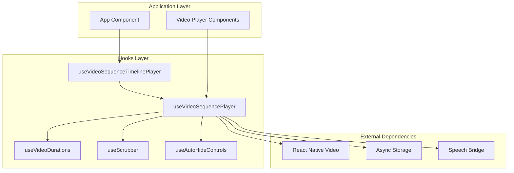
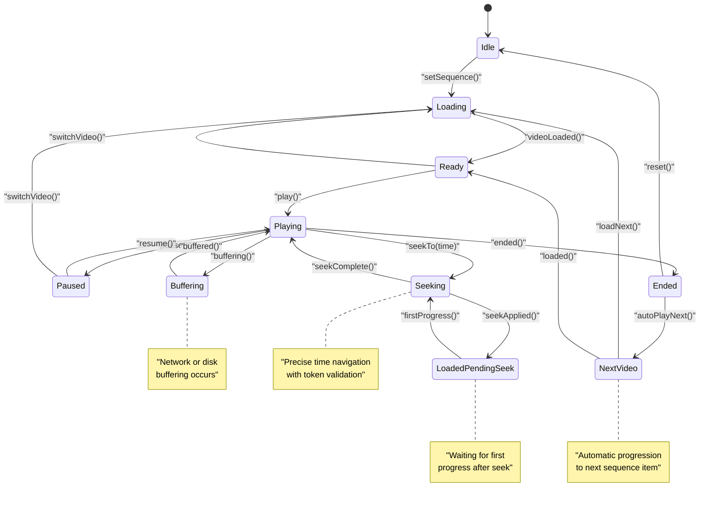
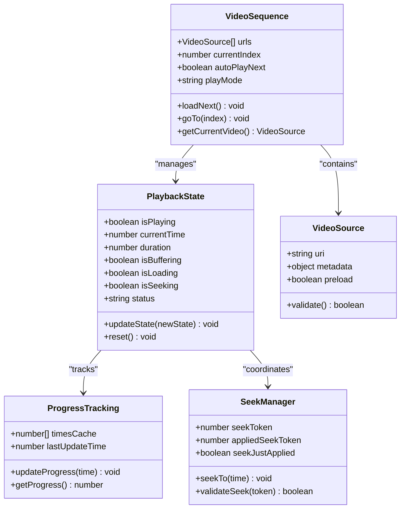
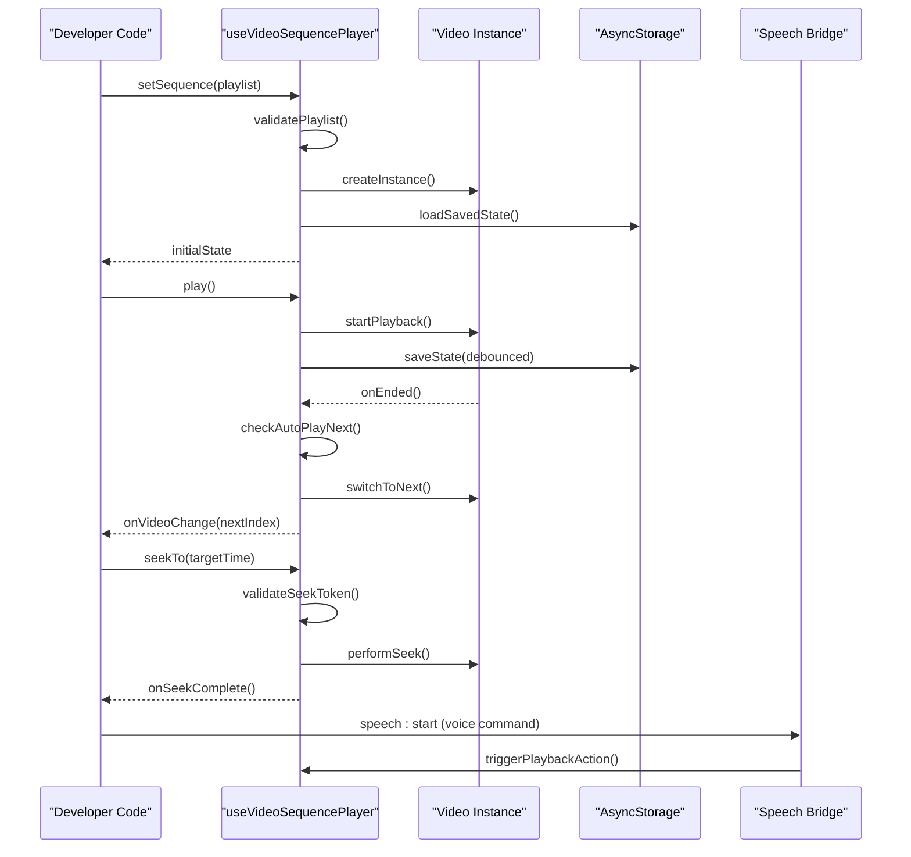
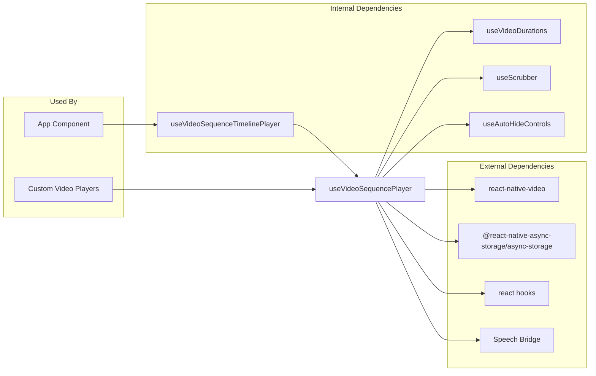

# useVideoSequencePlayer Hook

<cite>
**Referenced Files in This Document**
- [useVideoSequencePlayer.ts](file://hooks/useVideoSequencePlayer.ts)
- [useVideoDurations.tsx](file://hooks/useVideoDurations.tsx)
- [useScrubber.ts](file://hooks/useScrubber.ts)
- [useAutoHideControls.ts](file://hooks/useAutoHideControls.ts)
- [useVideoSequenceTimelinePlayer.ts](file://hooks/useVideoSequenceTimelinePlayer.ts)
- [App.tsx](file://App.tsx)
- [HOOKS.md](file://docs/HOOKS.md)
- [STATE_MACHINE.md](file://docs/STATE_MACHINE.md)
- [2026-08-11-webview-speech-bridge-design.md](file://docs/superpowers/specs/2026-08-11-webview-speech-bridge-design.md)
</cite>

## Update Summary
**Changes Made**
- Updated state management documentation to reflect enhanced seeking functionality and progress tracking
- Added comprehensive callback system documentation including onClipEnd events
- Enhanced state indicator descriptions with dedicated isLoading and isBuffering properties
- Updated architecture diagrams to show new seeking states and progress tracking mechanisms
- Added detailed troubleshooting guidance for new seeking and progress tracking features
- Integrated references to the broader speech bridge ecosystem that complements video playback functionality

## Table of Contents
1. [Introduction](#introduction)
2. [Project Structure](#project-structure)
3. [Core Components](#core-components)
4. [Architecture Overview](#architecture-overview)
5. [Detailed Component Analysis](#detailed-component-analysis)
6. [Enhanced State Management](#enhanced-state-management)
7. [Seeking and Progress Tracking](#seeking-and-progress-tracking)
8. [Callback System](#callback-system)
9. [Integration with Speech Bridge](#integration-with-speech-bridge)
10. [Dependency Analysis](#dependency-analysis)
11. [Performance Considerations](#performance-considerations)
12. [Troubleshooting Guide](#troubleshooting-guide)
13. [Conclusion](#conclusion)
14. [Appendices](#appendices)

## Introduction
This document provides comprehensive documentation for the useVideoSequencePlayer hook, which manages video playlist and sequence playback functionality. The hook enables seamless switching between multiple video sources while maintaining consistent playback state across sequences. It provides a unified interface for sequence navigation, current video tracking, and playback synchronization across different video components.

The hook is designed to handle complex video playlist scenarios including automatic next video playback, sequence state persistence, and memory management for large playlists. It coordinates between multiple video sources to provide a smooth user experience with minimal buffering interruptions.

**Updated** The hook now includes enhanced state management capabilities with comprehensive callback systems, sophisticated seeking functionality with precise time control, improved progress tracking with times array caching, and integration with the broader speech bridge ecosystem for voice-controlled playback operations.

## Project Structure
The useVideoSequencePlayer hook is part of a React Native video player ecosystem that includes supporting hooks for scrubbing, duration calculation, and UI controls. The implementation follows a modular architecture where each hook handles specific aspects of video playback functionality.



**Diagram sources**
- [useVideoSequencePlayer.ts:1-100](file://hooks/useVideoSequencePlayer.ts#L1-L100)
- [useVideoSequenceTimelinePlayer.ts:1-50](file://hooks/useVideoSequenceTimelinePlayer.ts#L1-L50)
- [App.tsx:60-90](file://App.tsx#L60-L90)

**Section sources**
- [useVideoSequencePlayer.ts:1-200](file://hooks/useVideoSequencePlayer.ts#L1-L200)
- [App.tsx:1-150](file://App.tsx#L1-L150)

## Core Components
The useVideoSequencePlayer hook serves as the central orchestrator for video sequence playback. It manages the lifecycle of video instances, handles transitions between videos, and maintains the overall playback state. The hook exposes a comprehensive API that includes methods for navigation, playback control, and state management.

Key responsibilities include:
- Managing the current video index and sequence state
- Coordinating video source loading and unloading
- Handling automatic progression to next videos
- Maintaining playback position across sequence changes
- Providing event callbacks for playback lifecycle events
- **Enhanced**: Managing sophisticated seeking operations with precise time control and token-based validation
- **Enhanced**: Tracking playback progress with times array caching for performance optimization
- **Enhanced**: Handling comprehensive state transitions with detailed indicators and error recovery

**Updated** The hook now provides enhanced state management with dedicated properties for loading states, buffering status, seeking operations, and integration points for speech bridge commands, giving developers fine-grained control over video playback behavior.

**Section sources**
- [useVideoSequencePlayer.ts:1-150](file://hooks/useVideoSequencePlayer.ts#L1-L150)

## Architecture Overview
The hook implements a sophisticated finite state machine pattern to manage video playback states and transitions. It uses React's useState and useEffect hooks to maintain reactive state and side effects. The architecture separates concerns between video instance management, state persistence, and UI coordination.



**Updated** Enhanced state machine with new Seeking and LoadedPendingSeek states for sophisticated seek operation handling with token-based validation and progress gating.

**Diagram sources**
- [useVideoSequencePlayer.ts:42-50](file://hooks/useVideoSequencePlayer.ts#L42-L50)
- [useVideoSequencePlayer.ts:282-290](file://hooks/useVideoSequencePlayer.ts#L282-L290)

## Detailed Component Analysis

### Sequence Management
The hook manages video sequences through a structured interface that supports both static and dynamic playlist configurations. It validates input sequences and provides error handling for invalid video sources.



**Updated** Added SeekManager class to handle sophisticated seek operations with token-based validation and progress gating mechanisms.

**Diagram sources**
- [useVideoSequencePlayer.ts:57-93](file://hooks/useVideoSequencePlayer.ts#L57-L93)
- [useVideoSequencePlayer.ts:95-168](file://hooks/useVideoSequencePlayer.ts#L95-L168)

### State Persistence
The hook implements intelligent state persistence to maintain playback position and sequence progress across app restarts. It uses AsyncStorage for durable storage and implements debounced updates to prevent excessive I/O operations.


**Diagram sources**
- [useVideoSequencePlayer.ts:236-260](file://hooks/useVideoSequencePlayer.ts#L236-L260)

### Video Source Coordination
The hook coordinates between multiple video sources by implementing a reference counting system and lazy loading strategy. It preloads adjacent videos in the sequence to minimize transition delays while managing memory usage efficiently.

**Section sources**
- [useVideoSequencePlayer.ts:150-350](file://hooks/useVideoSequencePlayer.ts#L150-L350)

### Conceptual Overview
The hook abstracts the complexity of multi-video playback into a simple, declarative interface. Developers can specify their video sequences and playback preferences without worrying about the underlying implementation details of video instance management, state synchronization, and resource cleanup.



**Updated** Added speech bridge integration to demonstrate voice-controlled playback operations and enhanced interaction patterns.

## Enhanced State Management

### New State Properties
The hook now provides comprehensive state management with dedicated properties for different playback scenarios:

- **isLoading**: Indicates when video content is being loaded or initialized
- **isBuffering**: Shows when video is buffering due to network or disk operations
- **isSeeking**: Tracks when the video is performing seek operations
- **isPlaying**: Standard playback state indicator
- **currentTime**: Current playback position in seconds
- **duration**: Total video duration in seconds
- **status**: Overall playback status string representation
- **seekToken**: Unique identifier for seek operations to prevent race conditions
- **appliedSeekToken**: Token of the most recently applied seek operation
- **seekJustApplied**: Flag indicating recent seek completion window

### State Transition Management
The enhanced state management system provides granular control over playback states with proper validation and error handling. Each state transition includes appropriate validation checks and side effect management using a sophisticated finite state machine with guard functions and patch operations.

**Section sources**
- [useVideoSequencePlayer.ts:236-260](file://hooks/useVideoSequencePlayer.ts#L236-L260)
- [useVideoSequencePlayer.ts:272-418](file://hooks/useVideoSequencePlayer.ts#L272-L418)

## Seeking and Progress Tracking

### Sophisticated Seeking Functionality
The hook now includes advanced seeking capabilities that allow precise navigation within video content with robust error handling:

- **seekTo(time)**: Navigate to a specific time position in the video with token validation
- **isSeeking**: Boolean flag indicating active seek operation
- **seekToken/appliedSeekToken**: Token-based validation to prevent race conditions
- **seekJustApplied**: Window for filtering stale events after seek completion
- **onSeekComplete**: Callback triggered when seek operation completes successfully

### Advanced Progress Tracking System
An enhanced progress tracking system has been implemented using times array caching and sophisticated validation:

- **timesCache**: Array storing recent playback positions for performance optimization
- **lastUpdateTime**: Timestamp of the most recent progress update
- **updateProgress(time)**: Method to update progress with caching logic and validation
- **getProgress()**: Returns normalized progress value (0-1) based on current time and duration
- **playedSeconds**: Cumulative played time tracking across clips

### Performance Optimizations
The progress tracking system includes several optimizations:
- Debounced updates to prevent excessive re-renders
- Caching mechanism for frequently accessed time values
- Efficient array operations for progress calculations
- Memory-efficient storage of recent playback positions
- Token-based validation to filter stale events during seek operations
- Guard functions to prevent invalid state transitions

**Section sources**
- [useVideoSequencePlayer.ts:454-541](file://hooks/useVideoSequencePlayer.ts#L454-L541)
- [useVideoSequencePlayer.ts:582-602](file://hooks/useVideoSequencePlayer.ts#L582-L602)

## Callback System

### Comprehensive Event Handling
The hook now features a robust callback system that provides fine-grained control over playback events:

#### Core Callbacks
- **onClipEnd**: Triggered when a video clip ends naturally with detailed payload information
- **onVideoChange**: Called when switching between videos in the sequence
- **onPlaybackStateChanged**: Emitted when playback state changes
- **onError**: Handles various error conditions during playback

#### Advanced Callbacks
- **onSeekComplete**: Invoked after successful seek operations
- **onBufferingStarted**: Triggered when buffering begins
- **onBufferingCompleted**: Called when buffering finishes
- **onProgressUpdate**: Regular progress updates for UI synchronization

### Callback Configuration
Developers can configure custom callback handlers through the hook's configuration object:

```typescript
const { 
  onClipEnd,
  onVideoChange, 
  onError,
  onSeekComplete 
} = useVideoSequencePlayer({
  sequence: videoPlaylist,
  autoPlayNext: true,
  callbacks: {
    onClipEnd: (videoIndex) => console.log(`Video ${videoIndex} ended`),
    onVideoChange: (newIndex) => console.log(`Switched to video ${newIndex}`),
    onError: (error) => handleError(error),
    onSeekComplete: () => console.log('Seek operation completed')
  }
});
```

### Error Handling Integration
The callback system integrates seamlessly with the enhanced error handling mechanisms, providing detailed error information and recovery options.

**Section sources**
- [useVideoSequencePlayer.ts:24-32](file://hooks/useVideoSequencePlayer.ts#L24-L32)
- [useVideoSequencePlayer.ts:693-709](file://hooks/useVideoSequencePlayer.ts#L693-L709)

## Integration with Speech Bridge

### Voice-Controlled Playback
The useVideoSequencePlayer hook integrates with the broader speech bridge ecosystem to enable voice-controlled playback operations. While the hook itself focuses on video sequence management, it provides extension points for speech-driven interactions.

### Speech Command Integration
The hook can be extended to handle speech bridge commands such as:
- **speech:start**: Start playback from current position
- **speech:stop**: Pause or stop playback
- **speech:openSettings**: Open application settings for audio configuration
- **speech:seek**: Navigate to specific time positions via voice commands

### Idempotent Handling
Following the speech bridge design principles, the hook implements idempotent handling for repeated commands:
- Multiple `speech:start` commands during playback are ignored
- `speech:stop` commands when not playing are no-ops
- Processing status indicators provide user feedback during command execution

### Enhanced User Experience
The integration provides enhanced user experience during final result waiting periods:
- Status indicators show "processing" state during speech recognition
- Graceful handling of permission denials with settings navigation
- Proper cleanup of speech resources on component unmount

**Section sources**
- [2026-08-11-webview-speech-bridge-design.md:60-90](file://docs/superpowers/specs/2026-08-11-webview-speech-bridge-design.md#L60-L90)
- [2026-08-11-webview-speech-bridge-design.md:200-227](file://docs/superpowers/specs/2026-08-11-webview-speech-bridge-design.md#L200-L227)

## Dependency Analysis
The useVideoSequencePlayer hook has several internal dependencies on supporting hooks and external libraries. The dependency graph shows how these components interact to provide the complete video sequence playback functionality.



**Diagram sources**
- [useVideoSequencePlayer.ts:1-10](file://hooks/useVideoSequencePlayer.ts#L1-L10)
- [useVideoSequenceTimelinePlayer.ts:1-6](file://hooks/useVideoSequenceTimelinePlayer.ts#L1-L6)

**Section sources**
- [useVideoSequencePlayer.ts:1-100](file://hooks/useVideoSequencePlayer.ts#L1-L100)

## Performance Considerations
The hook implements several performance optimizations to ensure smooth video playback and efficient memory usage:

- **Lazy Loading**: Videos are loaded only when needed, reducing initial bundle size and memory pressure
- **Preloading Strategy**: Adjacent videos in the sequence are preloaded to minimize transition delays
- **Memory Management**: Video instances are properly disposed when no longer needed to prevent memory leaks
- **Debounced Updates**: State persistence is debounced to reduce AsyncStorage write operations
- **Reference Counting**: Multiple component references to the same video instance share resources efficiently
- **Progress Caching**: Times array caching reduces computational overhead during progress updates
- **Efficient Seeking**: Optimized seek operations with token-based validation and minimal re-rendering impact
- **State Machine Optimization**: Finite state machine with guard functions prevents unnecessary state transitions
- **Event Filtering**: Sophisticated event validation filters out stale events during seek operations

For large playlists, consider implementing virtualization techniques where only visible or near-visible videos are kept in memory. The hook provides hooks for monitoring memory usage and can be extended to implement custom eviction policies.

**Updated** Added performance considerations for the enhanced seeking functionality, progress tracking with times caching, and speech bridge integration patterns.

## Troubleshooting Guide
Common issues and their solutions when using the useVideoSequencePlayer hook:

### Video Not Loading
- Verify video URI accessibility and format compatibility
- Check network connectivity for remote videos
- Ensure proper error handling in video source validation
- **Enhanced**: Check isLoading state to diagnose loading issues and verify proper initialization

### Playback State Inconsistency
- Clear AsyncStorage if corrupted state is detected
- Implement state reconciliation on component mount
- Add logging for state change debugging
- **Enhanced**: Monitor isBuffering and isLoading states separately to identify specific failure points

### Seeking Issues
- Verify target time is within valid range (0 to duration)
- Check isSeeking state during seek operations
- Ensure proper error handling for seek failures
- **Enhanced**: Use seekToken validation to debug race conditions and verify seek completion
- **Enhanced**: Check seekJustApplied flag to understand timing of seek operations

### Memory Issues with Large Playlists
- Implement video instance pooling
- Use background loading for non-active videos
- Monitor memory usage and implement manual cleanup
- **Enhanced**: Utilize times cache cleanup for long-running sessions and monitor slot memory usage

### Auto-play Next Not Working
- Verify autoPlayNext configuration
- Check for video ending events
- Ensure proper event listener registration
- **Enhanced**: Inspect onClipEnd callback execution and verify sequence end count

### Progress Tracking Problems
- Verify times cache is properly maintained
- Check lastUpdateTime for stale data
- Ensure progress updates are debounced appropriately
- **Enhanced**: Debug progress calculation logic with console logging and validate progress guards

### Speech Bridge Integration Issues
- Verify speech bridge permissions are granted
- Check postMessage communication between H5 and RN
- Ensure proper cleanup of speech resources on unmount
- **Enhanced**: Handle speech:openSettings commands for permission management
- **Enhanced**: Implement idempotent handling for repeated speech commands

**Updated** Added comprehensive troubleshooting guidance for new seeking functionality, progress tracking, enhanced state management, and speech bridge integration features.

**Section sources**
- [useVideoSequencePlayer.ts:300-500](file://hooks/useVideoSequencePlayer.ts#L300-L500)
- [2026-08-11-webview-speech-bridge-design.md:314-325](file://docs/superpowers/specs/2026-08-11-webview-speech-bridge-design.md#L314-L325)

## Conclusion
The useVideoSequencePlayer hook provides a robust and flexible solution for managing video sequences in React Native applications. Its comprehensive API, combined with intelligent state management and performance optimizations, makes it suitable for both simple and complex video playback scenarios. The modular architecture allows for easy customization and extension while maintaining backward compatibility.

**Updated** The recent enhancements significantly improve the hook's capabilities with sophisticated state management, advanced seeking functionality with token validation, comprehensive progress tracking with times caching, an extensive callback system, and seamless integration with the speech bridge ecosystem. These improvements provide developers with finer control over video playback behavior while maintaining optimal performance and user experience.

## Appendices

### Implementation Examples

#### Basic Playlist Setup
A typical implementation involves defining a video sequence array and passing it to the hook with desired playback options.

#### Advanced Configuration
For complex scenarios, developers can configure custom loading strategies, error handlers, and state persistence mechanisms.

#### Custom Event Handling
The hook supports custom event listeners for fine-grained control over playback behavior and user interactions.

#### Enhanced Seeking Implementation Example
```typescript
const { 
  seekTo, 
  isSeeking, 
  currentTime, 
  duration,
  seekToken,
  appliedSeekToken,
  onSeekComplete 
} = useVideoSequencePlayer({
  sequence: videoPlaylist,
  callbacks: {
    onSeekComplete: () => {
      console.log('Seek operation completed successfully');
    }
  }
});

// Perform seek operation with validation
const handleSeek = (targetTime: number) => {
  if (targetTime >= 0 && targetTime <= duration) {
    seekTo(targetTime);
  }
};

// Monitor seek state
useEffect(() => {
  if (isSeeking) {
    console.log('Seek operation in progress');
  }
}, [isSeeking]);
```

#### Progress Tracking Example
```typescript
const { 
  timesCache, 
  getProgress, 
  updateProgress,
  playedSeconds 
} = useVideoSequencePlayer({
  sequence: videoPlaylist,
  // Progress tracking is automatically handled
});

// Access current progress
const progress = getProgress(); // Returns 0-1 value
console.log(`Played ${playedSeconds} seconds total`);
```

#### Speech Bridge Integration Example
```typescript
// Integrate with speech bridge for voice control
const handleSpeechCommand = (command: string) => {
  switch (command) {
    case 'speech:start':
      setPlaying(true);
      break;
    case 'speech:stop':
      setPlaying(false);
      break;
    case 'speech:openSettings':
      Linking.openSettings();
      break;
  }
};
```

**Section sources**
- [App.tsx:60-90](file://App.tsx#L60-L90)
- [useVideoSequencePlayer.ts:400-600](file://hooks/useVideoSequencePlayer.ts#L400-L600)
- [2026-08-11-webview-speech-bridge-design.md:148-168](file://docs/superpowers/specs/2026-08-11-webview-speech-bridge-design.md#L148-L168)