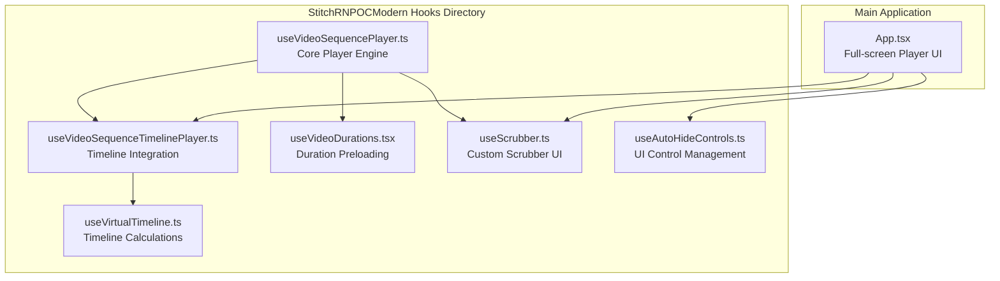
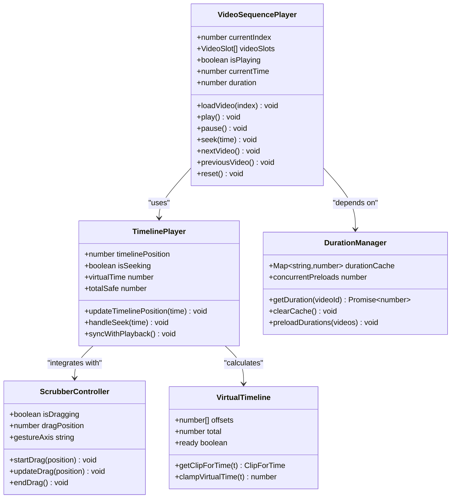
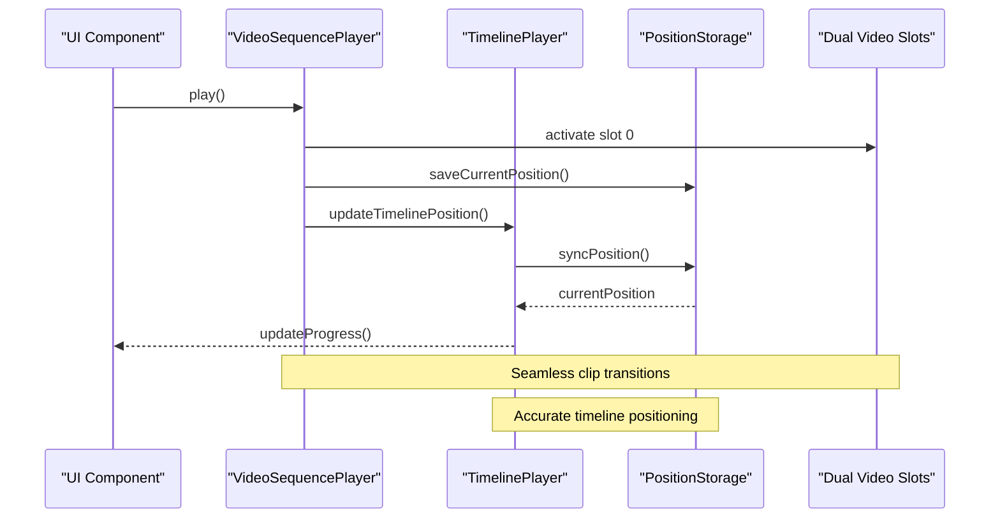
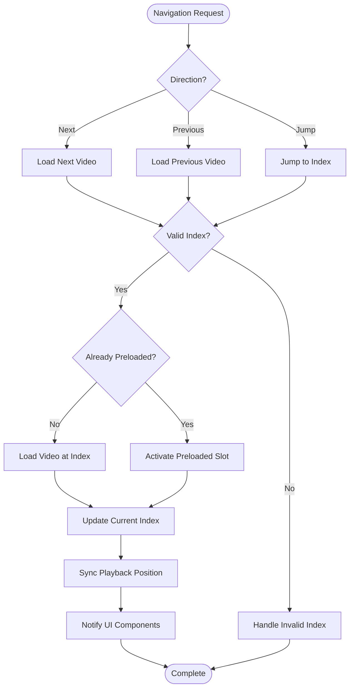
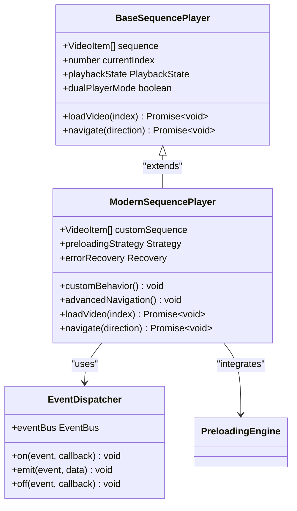
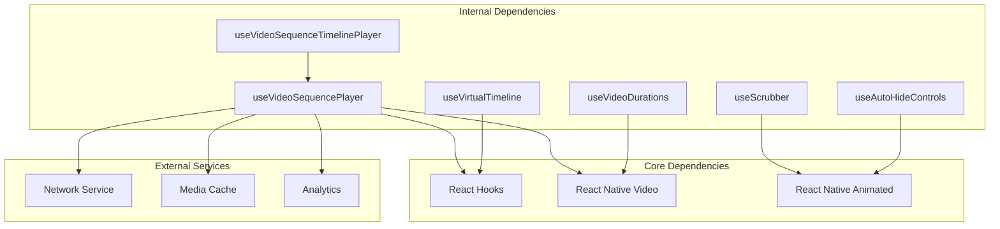

# Video Sequence State Management

<cite>
**Referenced Files in This Document**
- [useVideoSequencePlayer.ts](file://hooks/useVideoSequencePlayer.ts)
- [useVideoSequenceTimelinePlayer.ts](file://hooks/useVideoSequenceTimelinePlayer.ts)
- [useVideoDurations.tsx](file://hooks/useVideoDurations.tsx)
- [useScrubber.ts](file://hooks/useScrubber.ts)
- [useVirtualTimeline.ts](file://hooks/useVirtualTimeline.ts)
- [useAutoHideControls.ts](file://hooks/useAutoHideControls.ts)
- [App.tsx](file://App.tsx)
- [package.json](file://package.json)
- [README.md](file://README.md)
</cite>

## Update Summary
**Changes Made**
- Updated project naming from "Video Sequence Player" to "StitchRNPOCModern" throughout documentation
- Enhanced documentation to reflect the modern virtual video stitching architecture
- Added comprehensive coverage of the dual-player preload system and timeline synchronization
- Updated examples to reflect current implementation patterns and capabilities
- Enhanced troubleshooting section with modern error handling approaches

## Table of Contents
1. [Introduction](#introduction)
2. [Project Structure](#project-structure)
3. [Core Components](#core-components)
4. [Architecture Overview](#architecture-overview)
5. [Detailed Component Analysis](#detailed-component-analysis)
6. [Dependency Analysis](#dependency-analysis)
7. [Performance Considerations](#performance-considerations)
8. [Troubleshooting Guide](#troubleshooting-guide)
9. [Conclusion](#conclusion)

## Introduction

The **StitchRNPOCModern** video sequence state management system is designed to handle complex video playback scenarios across multiple videos in a React Native application. This modern implementation provides comprehensive state management for video sequences through virtual stitching, treating multiple MP4 clips as one continuous timeline with seamless navigation between videos. The system follows advanced React hooks patterns to ensure efficient state updates, optimal performance, and gapless transitions between video clips.

The core innovation lies in the dual-player preload system that maintains two video slots simultaneously - one active for current playback and one inactive for preloading the next clip. This enables seamless transitions without loading delays and supports precise seeking across clip boundaries within a unified timeline interface.

## Project Structure

The StitchRNPOCModern video sequence management system is organized within the `hooks` directory, containing specialized hooks for different aspects of video playback and timeline management:



**Diagram sources**
- [useVideoSequencePlayer.ts](file://hooks/useVideoSequencePlayer.ts)
- [useVideoSequenceTimelinePlayer.ts](file://hooks/useVideoSequenceTimelinePlayer.ts)
- [useVideoDurations.tsx](file://hooks/useVideoDurations.tsx)
- [useScrubber.ts](file://hooks/useScrubber.ts)
- [useVirtualTimeline.ts](file://hooks/useVirtualTimeline.ts)
- [useAutoHideControls.ts](file://hooks/useAutoHideControls.ts)
- [App.tsx](file://App.tsx)

**Section sources**
- [App.tsx](file://App.tsx)
- [package.json](file://package.json)
- [README.md](file://README.md)

## Core Components

### useVideoSequencePlayer Hook

The core engine responsible for managing video sequence state and playback logic in the StitchRNPOCModern system. This hook implements a sophisticated dual-player architecture:

- **Dual-Player System**: Maintains two video slots (active and inactive) for seamless transitions
- **Current Video Tracking**: Tracks the index and metadata of the currently playing video with precision
- **Playback Position Synchronization**: Ensures consistent playback positions across video transitions using token-based seek management
- **Sequence Navigation**: Provides methods for navigating forward, backward, and jumping to specific videos with preloading support
- **Advanced State Management**: Manages complex states including loading, buffering, seeking, and error recovery with robust state machine implementation

### useVideoSequenceTimelinePlayer Hook

A specialized hook that extends the base sequence player functionality with timeline-specific features for the modern stitching approach:

- **Timeline Integration**: Connects video playback with visual timeline components through virtual time calculations
- **Progress Tracking**: Monitors and updates playback progress in real-time with accurate position tracking
- **Seeking Support**: Enables precise seeking within video timelines with cross-clip boundary support
- **Timeline Events**: Handles user interactions with timeline controls and coordinate mapping

### Supporting Hooks

- **useVideoDurations**: Manages video duration calculations and caching with parallel preloading and retry logic
- **useScrubber**: Provides custom scrubbing functionality for manual time seeking with gesture support
- **useVirtualTimeline**: Optimizes timeline rendering and calculations for large video sequences with binary search
- **useAutoHideControls**: Manages UI control visibility during playback with animated transitions

**Section sources**
- [useVideoSequencePlayer.ts](file://hooks/useVideoSequencePlayer.ts)
- [useVideoSequenceTimelinePlayer.ts](file://hooks/useVideoSequenceTimelinePlayer.ts)
- [useVideoDurations.tsx](file://hooks/useVideoDurations.tsx)
- [useScrubber.ts](file://hooks/useScrubber.ts)
- [useVirtualTimeline.ts](file://hooks/useVirtualTimeline.ts)
- [useAutoHideControls.ts](file://hooks/useAutoHideControls.ts)

## Architecture Overview

The StitchRNPOCModern video sequence state management system follows a modular architecture with clear separation of concerns and advanced state management patterns:



**Diagram sources**
- [useVideoSequencePlayer.ts](file://hooks/useVideoSequencePlayer.ts)
- [useVideoSequenceTimelinePlayer.ts](file://hooks/useVideoSequenceTimelinePlayer.ts)
- [useVideoDurations.tsx](file://hooks/useVideoDurations.tsx)
- [useScrubber.ts](file://hooks/useScrubber.ts)
- [useVirtualTimeline.ts](file://hooks/useVirtualTimeline.ts)

## Detailed Component Analysis

### Video Sequence State Structure

The core state structure manages all aspects of video playback with sophisticated state machine implementation:

```mermaid
stateDiagram-v2
[*] --> Idle
Idle --> Loading : "loadVideo()"
Loading --> Ready : "video loaded"
Loading --> Error : "load failed"
Ready --> Playing : "play()"
Ready --> Paused : "pause()"
Playing --> Paused : "pause()"
Paused --> Playing : "play()"
Playing --> Buffering : "buffer needed"
Buffering --> Playing : "buffer ready"
Buffering --> Error : "buffer failed"
Error --> Loading : "retry"
Error --> Idle : "reset"
Paused --> Loading : "seek"
Playing --> Loading : "seek"
Ready --> Seeking : "seek initiated"
Seeking --> Ready : "seek applied"
Seeking --> Buffering : "seek requires buffer"
Buffering --> Seeking : "buffer ready"
Note over Playing,Seeking : Dual-player transition support
Note over Buffering,Seeking : Token-based seek coordination
```

**Diagram sources**
- [useVideoSequencePlayer.ts](file://hooks/useVideoSequencePlayer.ts)

### Playback Position Synchronization

The system ensures consistent playback positions through a centralized synchronization mechanism with token-based coordination:



**Diagram sources**
- [useVideoSequencePlayer.ts](file://hooks/useVideoSequencePlayer.ts)
- [useVideoSequenceTimelinePlayer.ts](file://hooks/useVideoSequenceTimelinePlayer.ts)

### Sequence Navigation Logic

Navigation between videos follows a structured flow with preloading optimization:



**Diagram sources**
- [useVideoSequencePlayer.ts](file://hooks/useVideoSequencePlayer.ts)

### Custom Sequence Behaviors

Implementing custom sequence behaviors involves extending the base hook functionality with advanced features:



**Diagram sources**
- [useVideoSequencePlayer.ts](file://hooks/useVideoSequencePlayer.ts)

**Section sources**
- [useVideoSequencePlayer.ts](file://hooks/useVideoSequencePlayer.ts)
- [useVideoSequenceTimelinePlayer.ts](file://hooks/useVideoSequenceTimelinePlayer.ts)

## Dependency Analysis

The StitchRNPOCModern video sequence system has well-defined dependencies between components with modern React Native integration:



**Diagram sources**
- [useVideoSequencePlayer.ts](file://hooks/useVideoSequencePlayer.ts)
- [useVideoSequenceTimelinePlayer.ts](file://hooks/useVideoSequenceTimelinePlayer.ts)
- [useVideoDurations.tsx](file://hooks/useVideoDurations.tsx)
- [useScrubber.ts](file://hooks/useScrubber.ts)
- [useVirtualTimeline.ts](file://hooks/useVirtualTimeline.ts)
- [useAutoHideControls.ts](file://hooks/useAutoHideControls.ts)

**Section sources**
- [useVideoSequencePlayer.ts](file://hooks/useVideoSequencePlayer.ts)
- [useVideoSequenceTimelinePlayer.ts](file://hooks/useVideoSequenceTimelinePlayer.ts)

## Performance Considerations

The StitchRNPOCModern video sequence system implements several advanced performance optimizations:

### Memory Management
- **Dual-Player Pooling**: Reuses two video player instances efficiently with automatic cleanup
- **Lazy Loading**: Videos are loaded only when needed with intelligent preloading strategies
- **Memory Cleanup**: Automatic cleanup of unused video resources and event listeners
- **Object Pooling**: Reuse of video player instances where possible to reduce allocation overhead

### Caching Strategies
- **Duration Caching**: Video durations are cached globally with retry logic and timeout handling
- **Thumbnail Caching**: Preloaded thumbnails for faster UI updates and smoother scrubbing
- **Metadata Caching**: Video metadata stored locally for quick access and reduced network calls
- **Timeline Caching**: Virtual timeline calculations cached with version-based invalidation

### Rendering Optimization
- **Virtual Scrolling**: Efficient rendering of large video lists with optimized re-rendering
- **Debounced Updates**: Throttled state updates to prevent excessive re-renders during playback
- **Memoization**: Cached computations for expensive operations like timeline calculations
- **Batched Updates**: Grouped state updates to minimize React re-renders

### Network Optimization
- **Concurrent Preloading**: Parallel duration fetching with configurable concurrency limits
- **Retry Logic**: Intelligent retry mechanisms with exponential backoff for failed requests
- **Timeout Handling**: Configurable timeouts for preload operations to prevent hanging
- **Connection Reuse**: Efficient HTTP connection reuse for multiple video requests

## Troubleshooting Guide

### Common Issues and Solutions

#### Video Loading Errors
- **Network Failures**: Implement retry logic with exponential backoff and fallback strategies
- **Invalid URLs**: Validate video URLs before loading with proper error handling
- **Format Compatibility**: Check supported video formats for target platforms with graceful degradation
- **Timeout Issues**: Configure appropriate timeouts and implement loading indicators

#### Playback Synchronization Issues
- **Time Drift**: Regularly sync playback time with actual video position using token-based coordination
- **Buffer Underruns**: Implement adaptive buffering strategies with quality switching
- **Memory Leaks**: Monitor memory usage during long playback sessions with proper cleanup
- **Seek Conflicts**: Handle concurrent seek operations with token-based conflict resolution

#### UI State Inconsistencies
- **Stale References**: Ensure proper cleanup of event listeners and animation timers
- **Race Conditions**: Use proper async/await patterns and state locks for state updates
- **Component Unmounting**: Handle component lifecycle properly with cleanup functions
- **Gesture Conflicts**: Manage touch events and gestures with proper priority handling

#### Advanced Troubleshooting Techniques
- **Logging**: Enable detailed logging for playback events with contextual information
- **Performance Monitoring**: Track memory usage, render performance, and network metrics
- **Error Boundaries**: Implement error boundaries to catch and report issues gracefully
- **Debug Tools**: Utilize React DevTools and performance profiling tools for debugging

### Platform-Specific Considerations

#### iOS-Specific Issues
- **Background Playback**: Configure background modes appropriately for seamless transitions
- **Memory Pressure**: Monitor memory usage and implement aggressive cleanup strategies
- **Network Restrictions**: Handle App Transport Security (ATS) configuration for HTTPS connections
- **Orientation Changes**: Handle orientation changes with proper state preservation

#### Android-Specific Issues
- **Hardware Acceleration**: Ensure hardware acceleration is enabled for smooth playback
- **Memory Management**: Implement proper resource cleanup due to Android's memory constraints
- **Network Configuration**: Handle network security configuration for secure connections
- **Lifecycle Management**: Properly handle activity lifecycle events and state preservation

**Section sources**
- [useVideoSequencePlayer.ts](file://hooks/useVideoSequencePlayer.ts)
- [useVideoSequenceTimelinePlayer.ts](file://hooks/useVideoSequenceTimelinePlayer.ts)
- [useVideoDurations.tsx](file://hooks/useVideoDurations.tsx)

## Conclusion

The StitchRNPOCModern video sequence state management system provides a robust foundation for handling complex video playback scenarios in React Native applications. Through its modern architecture featuring dual-player preloading, virtual timeline stitching, and comprehensive state management, it enables seamless navigation between videos, synchronized playback positions, and responsive UI updates.

Key innovations include:
- **Dual-Player Architecture**: Gapless transitions between video clips through intelligent preloading
- **Virtual Timeline**: Unified timeline abstraction across multiple video clips with precise seeking
- **Advanced State Management**: Sophisticated state machine with robust error handling and recovery
- **Performance Optimized**: Implements caching, lazy loading, memory management, and network optimization
- **Error Resilient**: Comprehensive error handling with retry logic and graceful degradation
- **Extensible Design**: Easy customization through hook composition and plugin architecture

The system successfully addresses the challenges of multi-video playback while maintaining clean code organization, optimal performance, and excellent user experience. Its modular design allows for easy maintenance and extension, making it suitable for both simple and complex video sequencing requirements in production applications.

The modern approach demonstrated in StitchRNPOCModern represents a significant advancement over traditional single-player video implementations, providing developers with a powerful toolkit for creating sophisticated video experiences in React Native applications.